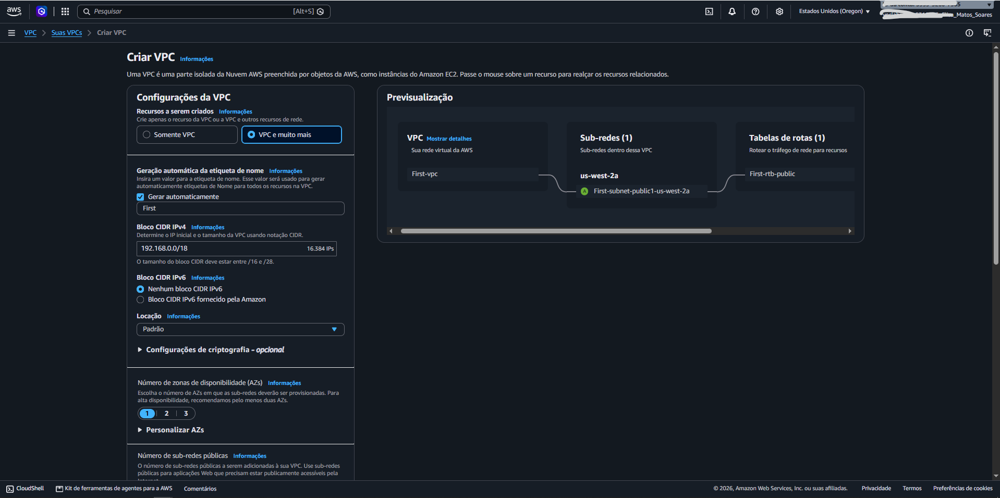
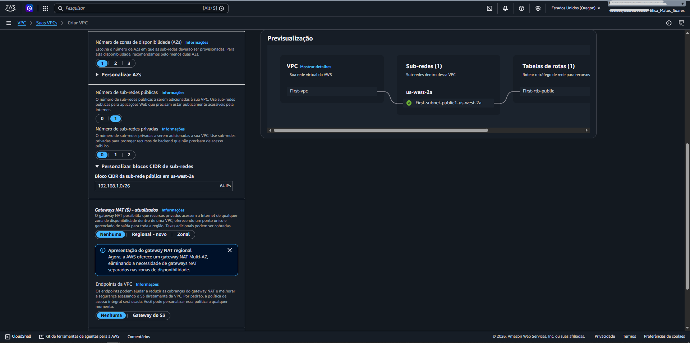
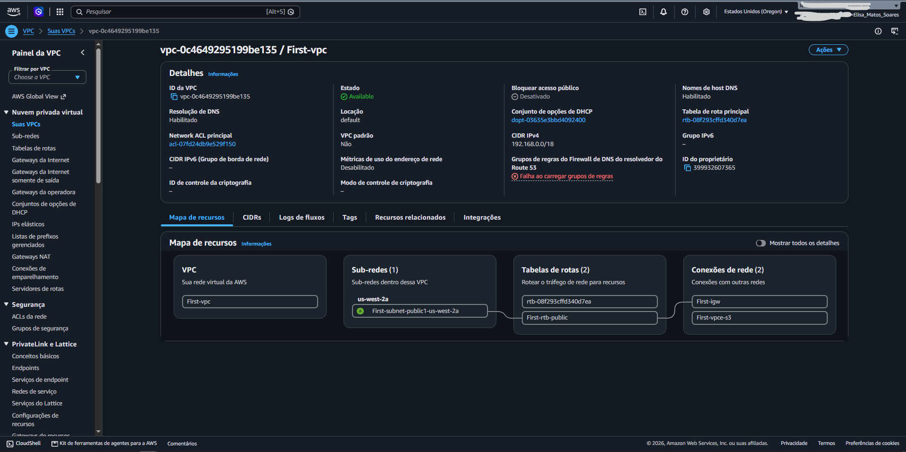

# 🌐 Resolvendo o Desafio de Rede da Startup: Criação de VPC e Sub-redes

Como Engenheiro de Suporte de Nuvem na AWS, fui acionado para resolver um chamado técnico crítico de uma startup. O proprietário, Paulo Santos, precisava de ajuda urgente para estruturar a sua primeira infraestrutura de rede na nuvem, garantindo capacidade de expansão e isolamento correto dos seus recursos.

---

## 🎯 O Desafio do Cliente (Ticket de Suporte)

> *"Olá, Suporte da Nuvem! Sou novo na AWS e preciso de ajuda para configurar uma VPC. Poderia me ajudar no processo de configuração? Eu gostaria de montar apenas a parte da VPC e gostaria que ela se parecesse com a figura da nossa arquitetura. Você pode me ajudar a garantir que eu tenha à disposição cerca de 15.000 endereços IP privados nessa VPC? Também gostaria que o bloco CIDR IPv4 da VPC fosse 192.x.x.x. Mas eu não me lembro qual é o intervalo privado. Você pode confirmar isso? Também gostaria de alocar pelo menos 50 endereços IP para a sub-rede pública."*
> 
> — **Paulo Santos, Proprietário de uma Startup**

---

## 🛠️ Plano de Ação e Solução Aplicada

Para resolver o problema do Paulo, executei a investigação das normas de endereçamento privado (RFC 1918) e dimensionei os blocos CIDR exatos para atender à demanda de 15.000 IPs internos e garantir mais de 50 IPs na sub-rede pública de operações. 

Abaixo estão os parâmetros técnicos validados para estruturar o ambiente dele:

| Parâmetro de Rede | Valor Escolhido | Justificativa da Solução |
| :--- | :--- | :--- |
| **Nome da VPC** | `First` | Identificação padronizada solicitada para o projeto inicial do cliente. |
| **Bloco CIDR da VPC** | `192.168.0.0/18` | Utiliza a faixa privada `192.x.x.x` recomendada e entrega uma capacidade de **16.384 endereços IP**, superando com folga a meta de 15.000 IPs solicitada. |
| **Zonas de Disponibilidade (AZs)** | `1` (ex: `us-west-2a`) | Foco na simplicidade da arquitetura inicial pedida no diagrama de operações. |
| **Sub-redes Públicas** | `1` sub-rede | Destinada ao departamento de operações com acesso direto à internet. |
| **Bloco CIDR da Sub-rede** | `192.168.1.0/26` | Oferece um sub-bloco otimizado com mais de 50 endereços IP utilizáveis para as instâncias públicas. |

---

## 📸 Passo a Passo da Solução e Evidências

### 1. Configurando os Parâmetros Iniciais e o Bloco CIDR da VPC
Acesseii o serviço **Amazon VPC** no Console de Gerenciamento da AWS, selecionei a criação assistida de recursos (*VPC and more*), defini a etiqueta como `First` e configurei o bloco CIDR principal para cobrir os 15.000 IPs exigidos pelo Paulo.

<!-- Print 1: Configuração inicial da VPC -->

  
   
  <em>Figura 1: Ajuste do bloco CIDR 192.168.0.0/18 para garantir a capacidade de IPs solicitada pelo cliente.</em>

---

### 2. Dimensionando a Sub-rede Pública do Departamento de Operações
Para atender ao pedido de pelo menos 50 endereços IP públicos para as operações da startup, ajustei as configurações personalizadas da sub-rede para o bloco `192.168.1.0/26` na Zona de Disponibilidade correta.

<!-- Print 2: Ajuste de sub-redes -->

  
   
  <em>Figura 2: Personalização da sub-rede pública dimensionada para o departamento de operações.</em>

---

### 3. Validação e Entrega da Infraestrutura ao Cliente
Após concluir o assistente de criação, validei todas as rotas, gateways e associações criadas automaticamente pela AWS, confirmando que a VPC `First-vpc` estava pronta e operacional para o Paulo iniciar os seus servidores.

<!-- Print 3: Sucesso e detalhes da VPC -->

  
   
  <em>Figura 3: Painel de êxito confirmando o provisionamento completo da infraestrutura de rede solicitada.</em>

---

## 💡 Conclusão do Atendimento
O chamado foi encerrado com sucesso. Demonstrei ao cliente como utilizar intervalos de IP privados seguros (padrão RFC 1918) e entreguei a ele uma VPC devidamente dimensionada com sub-redes capazes de suportar tanto o crescimento interno da empresa (15.000 IPs) quanto as operações públicas expostas à internet.

---

---

## 🧭 Navegação

&nbsp;&nbsp;

