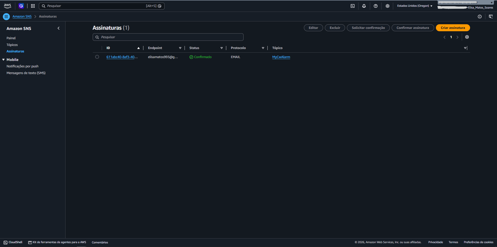
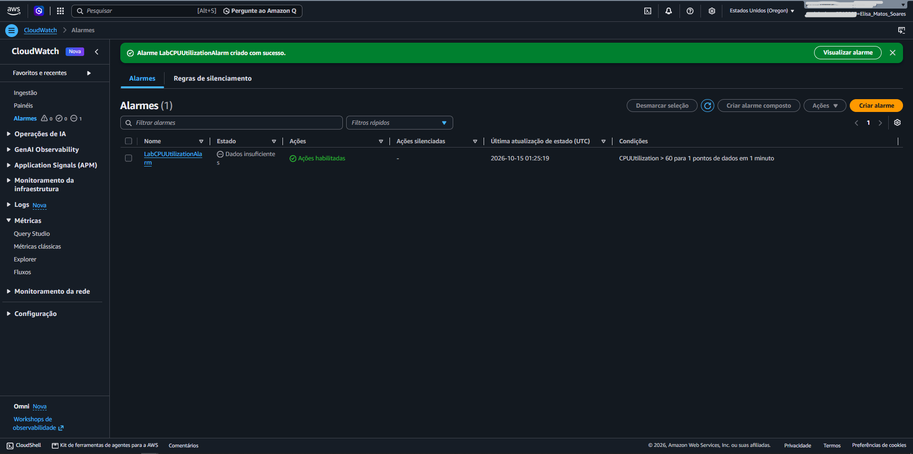
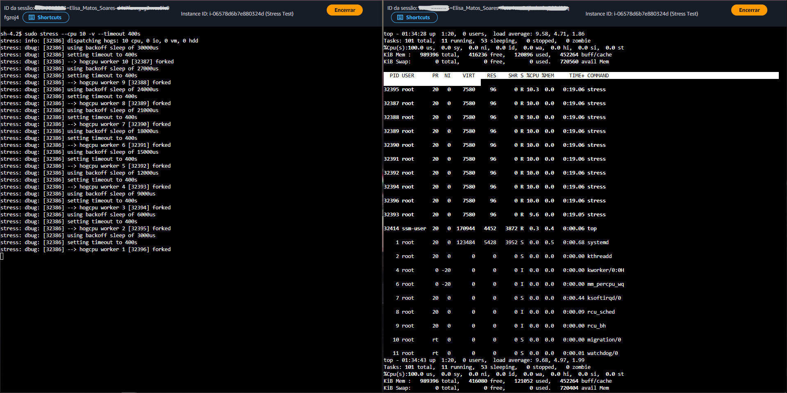
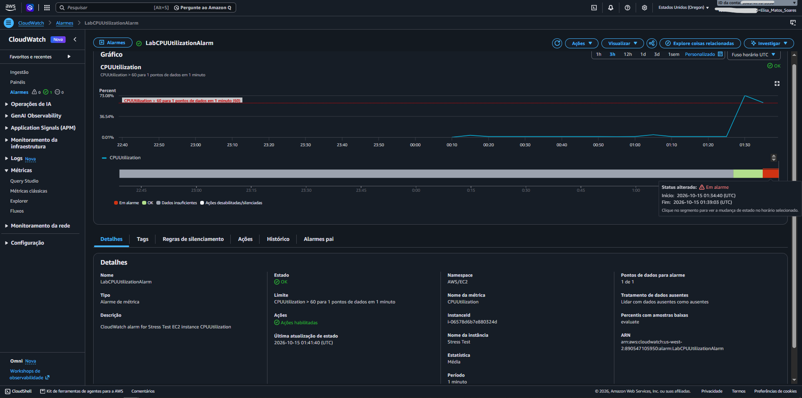
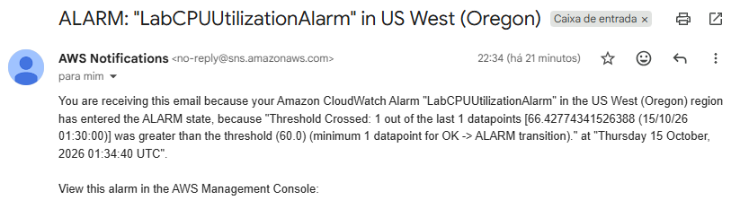
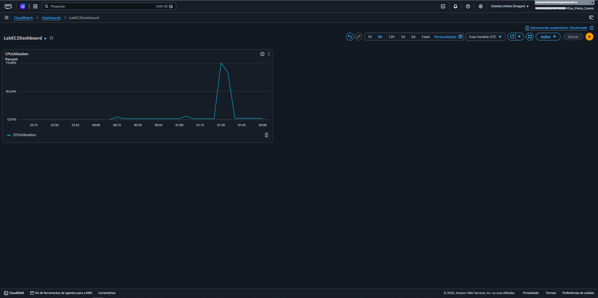

# 📊 Monitoramento e Alertas com Amazon CloudWatch e Amazon SNS

Neste laboratório prático, implementei uma rotina completa de observabilidade, monitoramento de métricas e disparo automatizado de notificações na nuvem utilizando o **Amazon CloudWatch** integrado ao **Amazon Simple Notification Service (Amazon SNS)**.

O objetivo do cenário foi simular a contenção e detecção de um incidente de segurança ou degradação de infraestrutura: um pico anômalo de utilização de CPU (atingindo 100%) em uma instância **Amazon EC2**, similar ao comportamento provocado por malwares de mineração de criptomoedas (crypto miners) ou processos desgovernados. Através de um alarme estático no CloudWatch acoplado a um tópico do SNS, validei o fluxo de notificação em tempo real e consolidei a visualização dos dados em um **CloudWatch Dashboard**.

---

## 🎯 O Que Eu Fiz

1. **Configuração de Mensageria com Amazon SNS:** Criei um tópico padrão (`MyCwAlarm`) e registrei uma assinatura do tipo e-mail, realizando a validação obrigatória de inscrição.
2. **Coleta e Análise de Métricas:** Inspecionei as métricas por instância no CloudWatch com foco na métrica `CPUUtilization` da instância `Stress Test`.
3. **Criação de Alarme Estático:** Configurei o alarme `LabCPUUtilizationAlarm` para disparar sempre que a utilização média de CPU ultrapassar o limite de **60%** em um período de 1 minuto.
4. **Execução de Teste de Estresse (Carga Sintética):** Conectei à instância via terminal e executei o utilitário `stress` para forçar o consumo de CPU a 100%, monitorando a evolução através do comando `top`.
5. **Validação de Disparo e Notificação:** Confirmei a transição de estado do alarme de *OK* para *In alarm*, observando o gráfico no CloudWatch e recebendo o e-mail de alerta gerado pelo SNS.
6. **Construção de Dashboard Operacional:** Desenvolvi o painel customizado `LabEC2Dashboard` com widget de linha para acompanhamento contínuo da saúde da instância.

---

## 🧱 Arquitetura e Componentes Principais

| Serviço / Recurso | Tipo | Papel no Cenário |
| :--- | :--- | :--- |
| **Amazon EC2 (`Stress Test`)** | Computação | Instância de trabalho submetida à carga sintética para simular consumo anormal de recursos. |
| **Amazon CloudWatch Metrics** | Telemetria | Coleta contínua da métrica `CPUUtilization` reportada pelo hipervisor da AWS. |
| **Amazon CloudWatch Alarms** | Alerta Automatizado | Monitora a métrica e avalia se o valor médio excede o limiar configurado (> 60%). |
| **Amazon SNS (`MyCwAlarm`)** | Mensageria / Notificação | Entrega de mensagens *Application-to-Person* (A2P) enviando alertas diretamente para o e-mail cadastrado. |
| **Amazon CloudWatch Dashboards** | Visualização | Painel centralizado e customizável para acompanhamento operacional em tempo real. |

---

## 📸 Passo a Passo e Evidências Práticas

## ✅ 1. Configuração do Tópico e Assinatura no Amazon SNS

No console do **Amazon SNS**, criei um tópico padrão para canalizar as notificações do alarme:

* **Tipo:** Padrão (*Standard*)
* **Nome:** `MyCwAlarm`
* **Protocolo da Assinatura:** `Email`
* **Endpoint:** Endereço de e-mail corporativo/pessoal para recebimento de alertas

Após a criação, acertei a validação clicando no link de autorização enviado pela AWS (*AWS Notification - Subscription Confirmation*), alterando o status da inscrição de `Pending confirmation` para `Confirmed`.

<!-- Print: Tópico SNS criado e inscrição confirmada -->
<p align="center">
  
  <br>
  <em>Figura 1: Assinatura de e-mail confirmada com sucesso no tópico MyCwAlarm do Amazon SNS.</em>
</p>

---

## ✅ 2. Criação do Alarme de Métricas no CloudWatch

No console do **Amazon CloudWatch**, localizei a métrica `CPUUtilization` referente à instância `Stress Test` (em *All metrics > EC2 > Per-Instance Metrics*) e montei o alarme de monitoramento:

* **Métrica:** `CPUUtilization`
* **Estatística:** Média (*Average*)
* **Período:** 1 minuto
* **Tipo de Limite:** Estático (*Static*)
* **Condição de Disparo:** Maior que (`>`) `60`
* **Ação:** Em estado de alarme (*In alarm*), enviar notificação para o tópico SNS `MyCwAlarm`
* **Nome do Alarme:** `LabCPUUtilizationAlarm`

<!-- Print: Configuração do alarme com o limite de 60% e ação associada ao tópico SNS -->
<p align="center">
  
  <br>
  <em>Figura 2: Alarme configurado para transitar para o estado In alarm quando a CPU exceder 60%.</em>
</p>

---

## ✅ 3. Execução do Teste de Estresse na Instância EC2

Acessei a instância `Stress Test` via sessão do **AWS Systems Manager** e disparei uma carga de processamento com o utilitário `stress`:

```bash
sudo stress --cpu 10 -v --timeout 400s
```
Em uma segunda janela de terminal conectada à mesma instância, executei o monitor de processos em tempo real:

```bash
top
```
O comando confirmou o consumo de processamento saltando imediatamente para 100%, emulando com sucesso o impacto operacional de um ataque de malware ou processo travado.

<!-- Print: Execução do Teste -->
<p align="center">
  
  <br>
  <em>Figura 3: Instância EC2 submetida a teste de estresse com 100% de uso de CPU sustentado.</em>
</p>

--- 

## ✅ 4. Validação da Transição para "In alarm" e E-mail Recebido

Com o consumo elevado durante a janela de avaliação de 400 segundos:

O gráfico da métrica no painel do alarme subiu abruptamente, superando a linha vermelha de corte fixada em 60%.

O status do `LabCPUUtilizationAlarm` mudou de `OK` para `In alarm`.

O Amazon SNS disparou a mensagem de alerta, que chegou à caixa de entrada contendo os detalhes do alarme, conta, métrica envolvida e timestamp do evento.

<!-- Print: Alarme em estado In alarm e notificação de e-mail -->
<p align="center">
  
  <br>
  <em>Figura 4: Alarme disparado no CloudWatch após superar o limiar de 60% e notificação entregue via SNS.</em>
</p>

<!-- Print: E-mail de notificação recebido via SNS -->
<p align="center">
  
  <br>
  <em>Figura 5: Notificação de alerta enviada pelo Amazon SNS para o e-mail cadastrado após o pico de CPU.</em>
</p>

--- 

## ✅ 5. Construção do Painel Operacional (CloudWatch Dashboard)
Para viabilizar monitoramento proativo contínuo sem depender de consultas manuais às métricas isoladas, criei um painel centralizado:

Nome do Painel: `LabEC2Dashboard`

Tipo de Widget: Linha (Line)

Métrica Mapeada: `CPUUtilization` da instância `Stress Test`

O dashboard fornece visão histórica e instantânea do ciclo de carga e alívio da instância, permitindo correlacionar métricas de diferentes fontes em uma visualização única.

<!-- Print: Dashboard do CloudWatch -->
<p align="center">
  
  <br>
  <em>Figura 6: Painel operacional LabEC2Dashboard consolidando o histórico da métrica da instância EC2.</em>
</p>

---

## 💡 Aprendizados e Boas Práticas
Monitoramento Proativo vs. Reativo: Estabelecer alarmes vinculados a tópicos de mensageria reduz drasticamente o tempo médio de detecção (MTTD), eliminando a necessidade de checagens visuais contínuas por parte dos operadores.

Ajuste de Granularidade e Períodos: A escolha de intervalos curtos (como 1 minuto) é ideal para testes e detecção de incidentes críticos, enquanto janelas mais longas (5 a 15 minutos) evitam alertas falsos-positivos em picos temporários e legítimos de processamento.

Integração com Mecanismos de Autorrecuperação: Além de disparar e-mails, alarmes do CloudWatch podem acionar ações diretas na infraestrutura, como políticas de escalabilidade automática (EC2 Auto Scaling) ou reinicialização automatizada da máquina (EC2 Actions).

---

## 🧭 Navegação

<div align="center">

<a href="https://github.com/elisasoares0/aws-cloud-practitioner-escola-da-nuvem/tree/main">
  
</a>
&nbsp;&nbsp;
<a href="https://github.com/elisasoares0/aws-cloud-practitioner-escola-da-nuvem/tree/main/docs/04-seguranca-e-governanca">
  
</a>

</div>