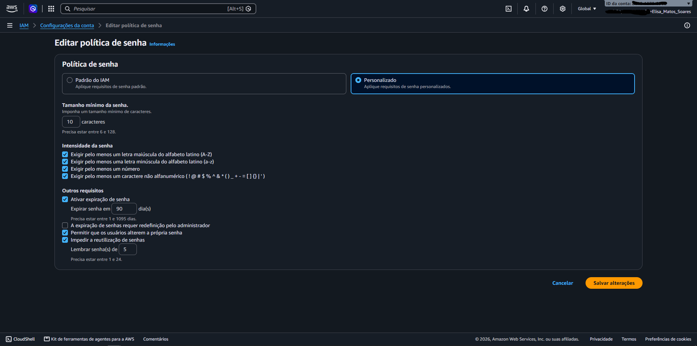
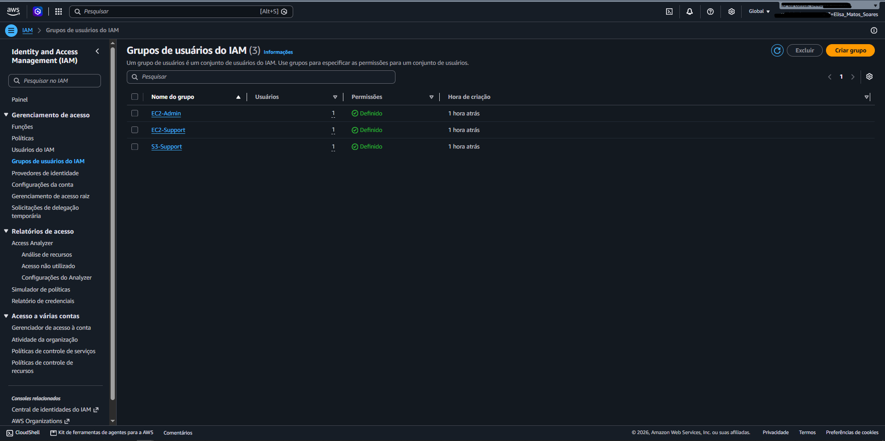
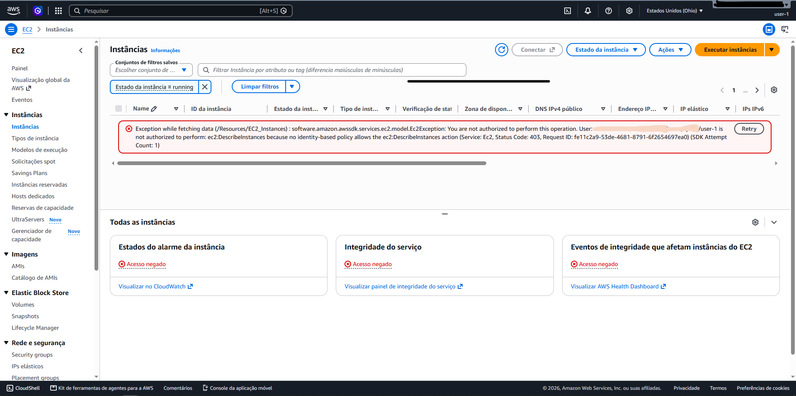
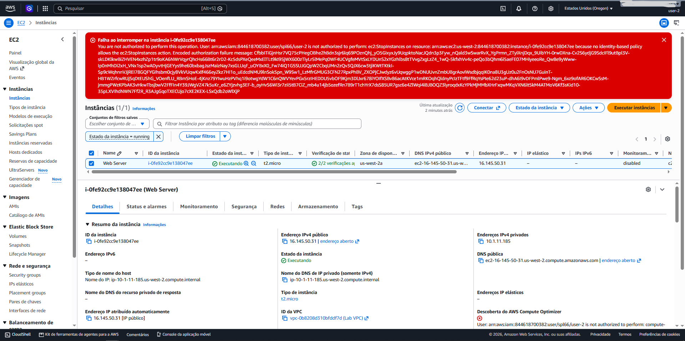
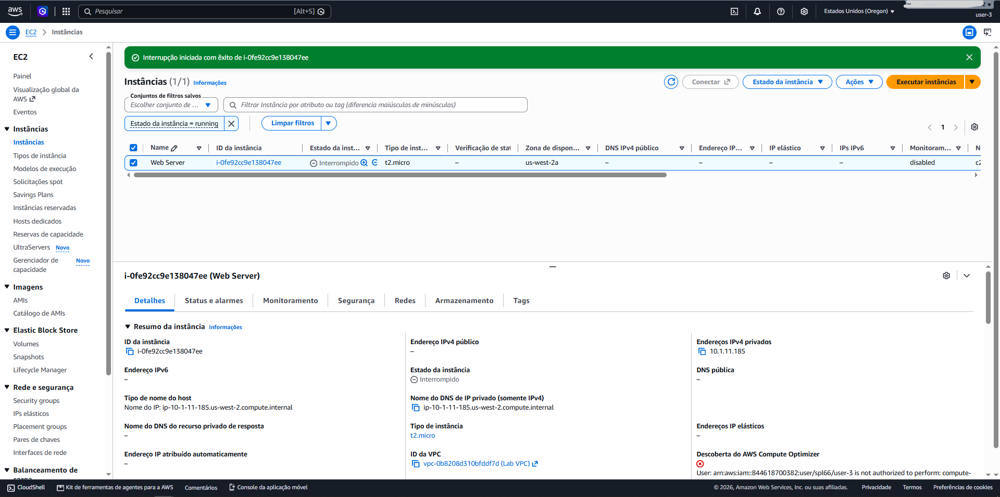

# 🔐 Gerenciamento de Identidades e Permissões com AWS IAM

Neste laboratório, explorei na prática como funciona o controle de acesso e a segurança de identidades na nuvem usando o **AWS Identity and Access Management (IAM)**. 

O grande objetivo aqui foi aplicar o **Princípio do Menor Privilégio (*Least Privilege*)**: em vez de dar acessos genéricos ou usar a conta root, organizei os acessos por equipes e funções de trabalho, garantindo que cada usuário só consiga ver e mexer exatamente no que precisa.

---

## 🎯 O Que Eu Fiz

1. **Fortalecimento da conta:** Ajustei a política de senhas global para exigir credenciais bem mais seguras.
2. **Organização por Grupos:** Analisei grupos pré-configurados e diferenciei políticas gerenciadas pela AWS (*Managed Policies*) de políticas incorporadas (*Inline Policies*).
3. **Distribuição de papéis:** Vinculei cada usuário ao seu grupo conforme a função de trabalho (Suporte S3, Suporte EC2 e Admin EC2).
4. **Testes reais na prática:** Usei navegação anônima para logar com cada identidade e comprovei na tela os acessos permitidos e os bloqueios (*Access Denied*).

---

## 👥 Cenário de Acesso e Regras de Negócio

Para simular o dia a dia de uma empresa, distribuí os acessos da seguinte forma:

| Usuário | Grupo | Política | O que pode fazer na prática |
| :--- | :--- | :--- | :--- |
| **user-1** | `S3-Support` | `AmazonS3ReadOnlyAccess` (Gerenciada) | Pode listar e visualizar buckets/arquivos no S3. Não tem acesso nenhum ao EC2. |
| **user-2** | `EC2-Support` | `AmazonEC2ReadOnlyAccess` (Gerenciada) | Consegue ver as instâncias EC2, mas não pode parar, iniciar ou alterar nada. Sem acesso ao S3. |
| **user-3** | `EC2-Admin` | `EC2-Admin-Policy` (Inline) | Administrador do EC2: pode listar, iniciar e parar instâncias. Sem acesso ao S3. |

---

## 📸 Passo a Passo e Evidências

### 1. Criando uma Política de Senhas Mais Rígida

A primeira coisa que fiz foi acessar o menu **Account settings** no IAM para sair da política básica e subir a barra de segurança da conta:

- Mínimo de **10 caracteres**.
- Exigência combinada de letras maiúsculas, minúsculas, números e símbolos.
- Rotação obrigatória de senha a cada **90 dias**.
- Histórico para impedir a repetição das últimas **5 senhas**.

<!-- Print: Configuração da política de senha salva -->

  
   
  <em>Figura 1: Nova política de senhas configurada para todos os usuários da conta AWS.</em>

---

### 2. Atribuindo Usuários aos Grupos

Em vez de sair colocando permissões soltas em cada usuário individualmente (o que vira uma bagunça quando a equipe cresce), usei a melhor prática de **Grupos de Usuários**:

- Adicionei o `user-1` ao grupo `S3-Support`.
- Adicionei o `user-2` ao grupo `EC2-Support`.
- Adicionei o `user-3` ao grupo `EC2-Admin`.

Dessa forma, os usuários herdam automaticamente as políticas vinculadas ao grupo sem retrabalho.

<!-- Print: Grupos com 1 usuário atribuído cada -->

  
   
  <em>Figura 2: Cada usuário alocado no seu respectivo grupo de trabalho.</em>

---

### 3. Testando os Acessos na Prática (Navegação Anônima)

Peguei a URL personalizada de login do IAM da conta e fiz os testes simulando cada colaborador em janelas privadas do navegador:

#### 🔹 Testando com o `user-1` (Suporte S3)
Consegui abrir o console do Amazon S3 normalmente e navegar pelo conteúdo dos buckets. Mas, quando tentei abrir o console do EC2 para ver os servidores, tomei o bloqueio esperado:  
`You are not authorized to perform this operation`.

<!-- Print: Acesso negado no EC2 para user-1 -->

  
   
  <em>Figura 3: user-1 conseguindo ver o S3, mas tomando 'Access Denied' no Amazon EC2.</em>

---

#### 🔹 Testando com o `user-2` (Suporte EC2)
Ao entrar com o `user-2`, o comportamento inverteu:
- No **EC2**, consegui listar as máquinas virtuais ativas. Porém, ao tentar clicar em **Stop instance** para parar uma delas, o painel retornou `Failed to stop the instance` (porque o grupo dele é apenas de leitura / suporte).
- No **S3**, a tentativa de listar os buckets retornou `You don't have permissions to list buckets`.

<!-- Print: Erro ao tentar parar instância com user-2 -->

  
   
  <em>Figura 4: user-2 visualiza as instâncias, mas é impedido de desligar o servidor.</em>

---

#### 🔹 Testando com o `user-3` (Admin EC2)
Por fim, entrei como `user-3`. Como ele herdou a política de administração do EC2:
- Acessei o console, selecionei a máquina e mandei **Stop instance**.
- O comando foi aceito imediatamente e a instância mudou para o status **Stopping**.
- O acesso ao S3 continuou bloqueado, já que a política dele era estrita para recursos de computação.

<!-- Print: Instância no estado Stopping com o user-3 -->

  
   
  <em>Figura 5: user-3 com permissão concedida para alterar o ciclo de vida da instância EC2.</em>

---

## 💡 O Que Levo Desse Laboratório

- **Segurança começa na identidade:** Sem uma boa gestão de credenciais e senhas fortes, qualquer controle de infraestrutura cai por terra.
- **Grupos facilitam a vida:** Mudar a permissão de um time inteiro mexendo apenas em um grupo é infinitamente mais seguro e rápido do que alterar usuário por usuário.
- **Diferença de políticas:** As *AWS Managed Policies* são excelentes para cobrir 90% dos casos comuns (como acessos read-only), enquanto as *Inline Policies* atendem a situações bem personalizadas onde você quer limitar verbos e ações específicas (como permitir apenas ligar/desligar instâncias).

---

## 🧭 Navegação

&nbsp;&nbsp;

